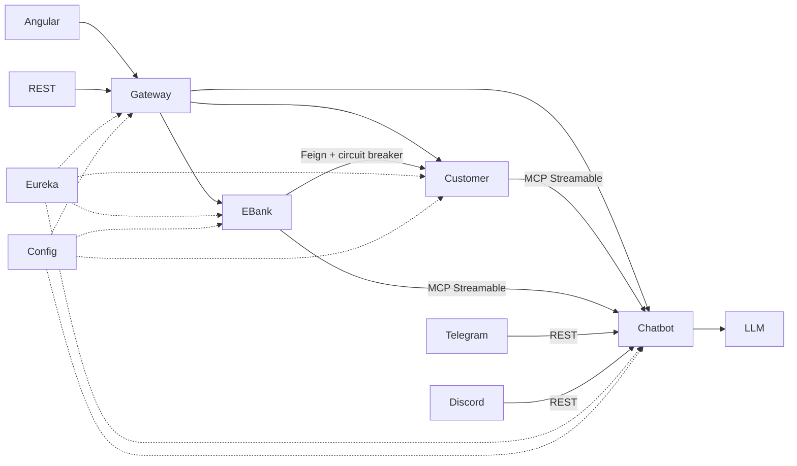

# Rapport de projet de synthèse — Systèmes Distribués et Agentic AI

**Université Hassan II — ENSET Mohammedia**  
**Enseignant :** Mohamed YOUSSFI  
**Étudiant :** [Nom à compléter]  
**Année :** 2026–2027  
**Projet :** EBank — Spring Boot, Spring Cloud, OpenFeign, Resilience4j, MCP et Spring AI

## Résumé

Le projet vise à mettre en place un système bancaire pédagogique à base de microservices. Il propose la gestion des clients, des comptes et des opérations bancaires, puis une couche d'agent conversationnel basée sur Spring AI, capable de consulter les données des microservices via MCP Streamable HTTP. Les interfaces REST, Angular, Telegram et Discord montrent plusieurs points d'accès à la même plateforme.

**Statut à la rédaction :** code source préparé ; compilation Maven/Angular et exécution de l'architecture intégrée **non vérifiées**. Les résultats ci-dessous sont des *critères de réussite attendus*, pas des preuves d'exécution. Les captures doivent provenir de l'environnement réel.

## 1. Analyse du besoin et architecture

Le sujet Google Classroom comporte **Partie 1 : backend distribué** et **Partie 2 : assistant IA / MCP / clients**. Le diagramme fourni dans le PDF du professeur (pages 2 et 6) relie le client Angular, Gateway, Customer Service, EBank Service, Discovery, Config Server, chatbot agent, LLM et Telegram. La page 7 présente spécifiquement l'intégration Chatbot–MCP–Telegram.

### Principales technologies

| Technologie | Rôle |
|---|---|
| Spring Boot / JPA / H2 | Microservices et persistance de démonstration |
| Eureka Discovery | Découverte par nom logique des instances |
| Spring Cloud Gateway | Routage `/api` vers les microservices |
| OpenFeign | Communication REST déclarative EBank → Customer |
| Resilience4j | Isolation d'échec et circuit breaker `customerLookup` |
| Spring Cloud Config | Externalisation des paramètres |
| Spring AI | ChatClient et communication LLM |
| MCP Streamable HTTP | Publication des outils clients et comptes |
| Angular | UI clients, comptes, opérations et chatbot |
| Telegram / Discord | Adaptateurs de chatbot, à tester avec bots réels |

## 2. Partie 1 — Backend Spring Cloud

### 2.1 Customer Service

Création d'une entité `Customer(id,name,email)`, `CustomerRepository` et contrôleur REST pour lister, lire, créer, modifier et supprimer un client. Base H2 indépendante. Deux clients fictifs sont insérés au démarrage pour le scénario de démonstration.

**Preuve requise :** capture Swagger UI sur `localhost:8081` et Postman `GET /api/customers`.

### 2.2 EBank Service

`BankAccount(id, customerId, type, balance, createdAt)` avec `CURRENT` et `SAVINGS` ; endpoints de création, dépôt, retrait, transfert, historique. Les transactions JPA utilisent des verrous pessimistes (ordre déterministe) pour les virements. Une table `AccountOperation` assure un historique pédagogique. Les soldes négatifs sont rejetés.

**Preuve requise :** captures création de compte, dépôt et retrait dans Postman + lecture de l'historique. Démontrer 1000 + 200 − 50 = 1150 MAD.

### 2.3 OpenFeign

`CustomerClient` résout `customer-service` par Eureka. Au moment de la création d'un compte, EBank vérifie que le client existe. Les services restent indépendants et ne partagent pas directement leur base de données.

**Preuve requise :** réponse POST compte valide et comportement quand Customer Service est arrêté.

### 2.4 Fault Tolerance / Circuit Breaker

Un circuit breaker nommé `customerLookup` entoure l'appel Feign. Sur indisponibilité client, le service émet une erreur `503 SERVICE_UNAVAILABLE` sans inventer l'existence d'un client. Les règles `failureRateThreshold`, `slidingWindowSize` et `waitDurationInOpenState` sont dans `application.yml`.

**Preuve requise :** arrêter le service clients, faire plusieurs tentatives de création de compte et capturer l'erreur contrôlée ainsi que les logs ; relancer les clients.

### 2.5 Gateway et Discovery

`discovery-service` écoute sur 8761. `gateway-service` sur 8080 publie `/api/customers`, `/api/accounts` et `/api/chat` avec les URI `lb://...` et la découverte Eureka. Le client Angular communique uniquement avec la Gateway.

**Preuve requise :** capture interface Eureka enregistrant les services et deux requêtes Postman sur `localhost:8080`.

### 2.6 Config Server

`config-service` sur 8888 avec backend natif et ressources `config-repo`. Les autres services déclarent `optional:configserver:` dans leur `application.yml`.

**Preuve requise :** `GET http://localhost:8888/ebank-service/default` renvoyant la configuration externalisée.

## 3. Partie 2 — Agentic AI + MCP

### 3.1 Serveurs MCP Streamable HTTP

Le Customer Service expose des outils de lecture `listCustomers` et `getCustomer`. Le service EBank expose `listBankAccounts`, `getBankAccount`, `accountsForCustomer`, `getAccountOperations`. Le framework publie `/mcp` sur chaque port métier (8081/8082) via Spring AI MCP WebMVC.

**Preuve requise :** initialisation MCP + `tools/list` dans MCP Inspector, puis appel d'au moins un outil de chaque service.

### 3.2 Agent Spring AI

`chatbot-service` sur 8083 utilise un `ChatClient` et les MCP ToolCallbacks récupérés des deux serveurs. Il est configuré par une clé OpenAI **personnelle non publiée**, sous forme de variable `OPENAI_API_KEY`. L'agent répond aux demandes en langage naturel en consultant les outils plutôt qu'en inventant des données.

**Preuve requise :** réponse REST de `POST /api/chat/ask` demandant la liste des comptes et réponse utilisant les données réellement présentes.

### 3.3 Clients utilisateurs

Le client Angular présente une vue générale, un annuaire de clients, le catalogue des comptes, les opérations bancaires, l'historique et le chat. Telegram utilise Bot API en long polling et Discord utilise `discord.py`. Ces clients utilisent l'API REST du chatbot.

**Preuve requise :** captures Angular dashboard et chat. Pour Telegram/Discord, captures des conversations réelles avec le bot dans une conversation autorisée.

## 4. Sécurité et limites

1. Le projet utilise des clients et comptes **fictifs**, sans authentification bancaire ; il ne doit jamais servir à gérer de vrais fonds.
2. Les outils MCP sont intentionnellement **read-only**, pour éviter de modifier les comptes à partir d'un message non authentifié.
3. Les bots Telegram et Discord ne fonctionnent qu'avec des allowlists de chat/user IDs ; leurs tokens ne sont jamais enregistrés dans Git.
4. L'exemple de clé OpenAI publié dans Classroom est **compromis** et doit être révoqué, jamais repris.
5. Les données H2 sont en mémoire. Pour production, préférer une base persistante, migrations, audit immuable, authentification OAuth2/Keycloak, autorisation par propriétaire, chiffrement, observabilité et idempotence métier.
6. Dans cette implémentation, une erreur métier (client inconnu) est traitée par le circuit breaker comme indisponibilité ; l'amélioration naturelle serait de distinguer 404 métier et pannes réseau.

## 5. Plan de test et preuves à compléter

| Test | Critère d'acceptation | Résultat réel |
|---|---|---|
| Maven `clean verify` | Build et tests verts | **Non exécuté** |
| Angular `npm run build` | Build terminé sans erreur | **Non exécuté** |
| Eureka :8761 | Instances présentes | **Non vérifié** |
| Config Server :8888 | JSON des propriétés affiché | **Non vérifié** |
| Customer REST | CRUD correct | **Non vérifié** |
| EBank REST | 1000+200−50=1150 | **Non vérifié** |
| OpenFeign | Client résolu | **Non vérifié** |
| Resilience4j | Erreur contrôlée si service absent | **Non vérifié** |
| MCP Inspector | 2 serveurs et outils disponibles | **Non vérifié** |
| Spring AI REST | Réponses fondées sur outils MCP | **Non vérifié** |
| Angular | Parcours client et compte | **Non vérifié** |
| Telegram | Message / réponse réelle | **Non vérifié** |
| Discord | Message / réponse réelle | **Non vérifié** |

## 6. Conclusion

L'architecture sépare les responsabilités métier et l'agent IA ; Eureka et Gateway facilitent le découplage, OpenFeign fournit des appels inter-services et MCP évite de coupler le LLM aux APIs internes. Les prochaines étapes consistent à exécuter l'ensemble, corriger tout problème remonté par Maven/Docker, capturer les preuves et compléter les résultats du rapport.

## Références

- Classroom « Projet — Systèmes Distribués », 5 octobre 2026.
- Professeur Mohamed Youssfi, *Projet de synthèse Spring Boot, Spring Cloud, Agentic AI* (PDF fourni, pages 2, 6, 7).
- https://www.youtube.com/watch?v=cdFz3VemT1Q
- https://www.youtube.com/watch?v=JHvxSZTWSsY
- https://www.youtube.com/watch?v=wDheR7_2jkQ
- https://docs.spring.io/spring-ai/reference/1.1/api/mcp/mcp-client-boot-starter-docs.html
