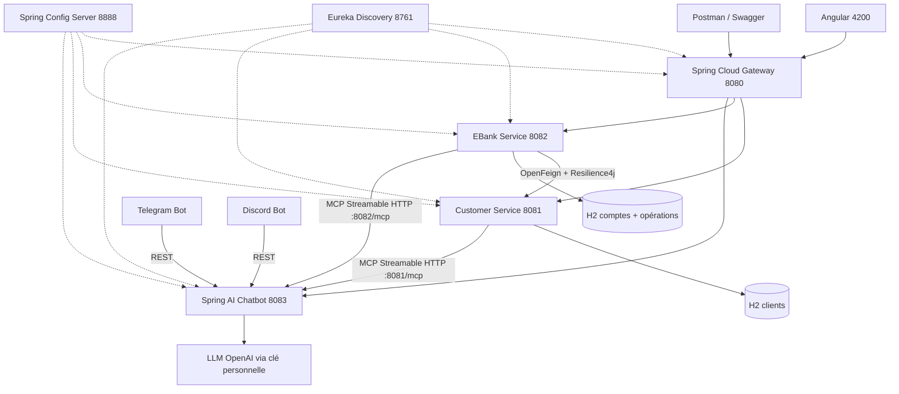

# Projet de synthèse — Spring Boot · Spring Cloud · Agentic AI · MCP

**ENSET Mohammedia · Systèmes Distribués et DevOps · Enseignant : Mohamed YOUSSFI · II-BDCC3**

Cette réalisation suit l'énoncé **« Projet - Systèmes Distribués »** fourni dans Google Classroom et son PDF **« Projet de synthèse Spring Boot, Spring Cloud, Agentic AI »**. Elle reprend l'architecture demandée (Customer Service, EBank Service, OpenFeign, Resilience4j, Spring Cloud Gateway, Discovery, Configuration, Spring AI, MCP Streamable HTTP et clients REST/Angular/Telegram/Discord) dans un code indépendant des vidéos.

> **État : code et configuration préparés. Le build Java et Angular et l'exécution de tous les services n'ont pas pu être réalisés dans l'environnement de préparation. Les résultats et captures réels doivent être obtenus localement avant remise.**
>
> **Sécurité importante : la clé OpenAI visible dans la capture Classroom est exposée. Elle doit être révoquée, et une nouvelle clé doit rester uniquement dans `.env` ou des variables d'environnement locales. Aucune clé n'est incluse dans ce projet.**
>
> Les comptes, soldes et opérations sont **strictement pédagogiques**. Aucun mécanisme de connexion/autorisation bancaire n'est fourni. Ne connectez jamais de vrais comptes ni des données personnelles réelles à l'API ou aux bots.

## 1 — Architecture



**L'agent n'a que des outils MCP de lecture.** Les écritures bancaires (dépôt, retrait, virement) passent par la couche REST directe et sont protégées par des validations. Un véritable service bancaire exigerait authentification, autorisations par utilisateur, audit sécurisé, idempotence et persistance production.

## 2 — Correspondance avec le travail demandé

| Consigne du professeur | Livrable |
|---|---|
| Partie 1 : Customer Service | `customer-service` — JPA/H2, CRUD REST, 2 données de démo, Swagger, MCP |
| Partie 1 : EBank Service | `ebank-service` — comptes courant/épargne, soldes, dépôts, retraits, virements, opérations |
| Communication OpenFeign | `CustomerClient` + `CustomerLookup` entre EBank et Customer |
| Fault Tolerance Resilience4j | `CircuitBreakerFactory` + configuration `customerLookup`; **erreur contrôlée**, pas de faux client |
| Spring Cloud Gateway | `gateway-service` — routage `lb://` vers les services |
| Discovery Service | `discovery-service` — Eureka sur `8761` |
| Tests REST Postman et Swagger | Collection sous `postman/`, Swagger `/swagger-ui/index.html` sur Customer/EBank |
| Partie 2 : Spring AI chatbot | `chatbot-service` — ChatClient avec modèle OpenAI via environnement |
| Exposer microservices via MCP | Tools read-only dans `customer-service` et `ebank-service`, transport Streamable HTTP `/mcp` |
| Tester via MCP client | Client Spring AI et script de contrôle `scripts/test_mcp.py` |
| Connecter le chatbot via MCP | `chatbot-service` MCP client → deux serveurs MCP |
| Tester chatbot via REST | POST `http://localhost:8083/api/chat/ask` ou Gateway `/api/chat/ask` |
| Tester Telegram | `bot-adapters/telegram_bot.py`, token et allowlist requis |
| Tester Discord | `bot-adapters/discord_bot.py`, token et allowlist requis |
| Client Angular montré dans l'architecture | `web-client` : dashboard, clients, comptes, opérations, chat |
| Configuration Service (diagramme PDF) | `config-service` avec repo `classpath:/config-repo` |

### Versioning

- Java **21**, Spring Boot **3.5.15**, Spring Cloud **2025.0.1**, Spring AI **1.1.8** (choisis pour une compatibilité Boot 3.5).
- H2, Spring Data JPA, OpenFeign, Resilience4j, Spring Cloud Gateway, Eureka, Spring Cloud Config, Swagger/OpenAPI (springdoc 2.8.15), Angular 19.
- Le chatbot nécessite une clé **OpenAI neuve et valide**, un compte disposant de l'accès API et de la facturation configurée si requise.

## 3 — Démarrage simple sans clé OpenAI

Depuis le dossier racine du projet, avec Docker Desktop démarré :

```bash
docker compose up --build -d
```

**Le chatbot ne fait pas partie du compose par défaut.** Ceci permet de tester la première partie du projet sans aucun secret.

Après le temps d'enregistrement Eureka, ouvrir :

| Composant | Adresse |
|---|---|
| Angular | http://localhost:4200 |
| Eureka | http://localhost:8761 |
| Gateway API comptes | http://localhost:8080/api/accounts |
| Gateway API clients | http://localhost:8080/api/customers |
| Swagger Customer | http://localhost:8081/swagger-ui/index.html |
| Swagger EBank | http://localhost:8082/swagger-ui/index.html |
| Spring Cloud Config | http://localhost:8888/ebank-service/default |
| Customer MCP | http://localhost:8081/mcp (MCP POST, **pas** une page HTML) |
| EBank MCP | http://localhost:8082/mcp (MCP POST, **pas** une page HTML) |

Pour contrôler :

```bash
docker compose ps
python scripts/smoke_test.py
python scripts/test_mcp.py
```

Le script MCP est un test de protocole de base (certaines révisions MCP nécessitent un échange de notification `initialized` avant `tools/list`). Pour un test interactif complet, utiliser **MCP Inspector** ou le client Java du service Chatbot.

**Dépannage :** `docker compose logs --tail=100 ebank-service customer-service gateway-service`. Les services peuvent mettre quelques secondes à rejoindre Eureka et à trouver Config Server au premier lancement. Réessayer la requête après l'enregistrement.

## 4 — Démarrage de l'agent Spring AI

Ne réutilisez pas la clé publique figurant dans les captures.

1. Révoquer cette clé, puis générer une **nouvelle** clé API.
2. Copier `.env.example` en `.env` ; renseigner **uniquement localement** `OPENAI_API_KEY`.
3. Lancer **les deux compose** :

```bash
docker compose -f docker-compose.yml -f docker-compose.ai.yml up --build -d
```

4. Utiliser l'API REST :

```bash
curl -X POST http://localhost:8083/api/chat/ask  -H 'Content-Type: application/json'  -d '{"message":"Liste tous les comptes bancaires"}'
```

L'agent peut appeler `listCustomers`, `getCustomer`, `listBankAccounts`, `getBankAccount`, `accountsForCustomer`, `getAccountOperations` au moyen du transport **Streamable HTTP MCP**. Les ressources MCP sont découvertes pendant le démarrage du chatbot : lancer Customer/EBank avant Chatbot. Si le Chatbot a démarré trop tôt, le redémarrer.

## 5 — Tester les parcours banque

Le Customer Service crée des clients pédagogiques au premier démarrage. Utiliser leurs identifiants via `GET /api/customers`, puis :

```http
POST /api/accounts
Content-Type: application/json

{"customerId":1,"type":"CURRENT","initialBalance":1000}
```

Reprendre le UUID du compte retourné pour :

```http
POST /api/accounts/{id}/deposit   {"amount":200}
POST /api/accounts/{id}/withdraw  {"amount":50}
GET  /api/accounts/{id}/operations
```

Résultat **attendu** : 1000 + 200 − 50 = **1150 MAD**. Le contrôle de solde refuse un retrait excessif. Les virements entre deux comptes sont faits dans une seule transaction locale JPA avec ordre déterministe des verrous. Pour un vrai système financier, il manquerait de nombreuses garanties de sécurité et de conformité.

La collection Postman `postman/Projet_EBank_Agentic_AI.postman_collection.json` importe toutes les requêtes ; modifier la variable `accountId` après création du compte.

## 6 — Démarrer dans IntelliJ (sans Docker)

1. Ouvrir le projet Maven à la racine, synchroniser les dépendances.
2. Démarrer `DiscoveryApplication` (8761), puis `ConfigApplication` (8888).
3. Démarrer `CustomerApplication` (8081), `EbankApplication` (8082), puis `GatewayApplication` (8080).
4. Lancer les tests Postman ou `python scripts/smoke_test.py`.
5. Dans `web-client`, exécuter `npm install`, puis `npm start` ; ouvrir `localhost:4200`.
6. Pour l'IA, définir `OPENAI_API_KEY` dans la configuration de lancement IntelliJ (pas dans Git), puis démarrer `ChatbotApplication` (8083) **après** les deux serveurs MCP.

### Services externes

Les deux scripts de `bot-adapters/` sont **optionnels et arrêtés par défaut**, car ils exigent des bots réels, des tokens et des allowlists d'utilisateurs. Voir `bot-adapters/README.md`.

## 7 — Tests, vérifications et remise

- `mvn clean test` : test JPA clients et tests d'invariants financiers (`BankAccountTest`).
- `python scripts/smoke_test.py` : vérifie les services et la Gateway depuis l'extérieur.
- `python scripts/test_mcp.py` : handshake MCP sur les ports 8081/8082.
- `npm run build` dans `web-client` : compilation Angular.
- `.github/workflows/ci.yml` : Maven + Angular + syntaxe Python à chaque push.
- `RAPPORT_PROJET.md` : rapport en français avec preuves à fournir.

**Éléments indispensables avant la remise** : captures réelles Eureka, Swagger/Postman, circuit breaker en erreur, tools/list et appels MCP, réponse AI, interface Angular, Telegram et Discord (si comptes/configurations disponibles), résultats Maven/Angular. Ne pas inventer des tests réussis.

## 8 — Sources du sujet

- Google Classroom, **Projet — Systèmes Distribués**, 5 octobre 2026.
- Vidéo Partie 1 : https://www.youtube.com/watch?v=cdFz3VemT1Q
- Vidéo Partie 2 : https://www.youtube.com/watch?v=JHvxSZTWSsY
- Vidéo Partie 3 : https://www.youtube.com/watch?v=wDheR7_2jkQ
- PDF : « Projet de synthèse Micro services Spring Cloud Agentic AI MCP Angular Telegram » (schémas pages 2, 6 et 7).
- Documentation : https://docs.spring.io/spring-ai/reference/1.1/api/mcp/mcp-streamable-http-server-boot-starter-docs.html ; https://docs.spring.io/spring-cloud-gateway/reference/4.3/spring-cloud-gateway-server-webflux/configuration.html
